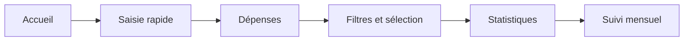

<!-- MON_BUDGET_FRISE_GRAPHIQUE -->


# Mon Budget V2

**Application Android de gestion de budget personnel**

Une application Flutter conçue pour suivre ses revenus, ses dépenses et son budget mensuel avec une interface sombre, épurée et pratique.

Développement : **chosebleu**

## Fonctionnalités

| Fonction | Description |
|---|---|
| Accueil | Consultation du solde réel et du reste à vivre |
| Saisie rapide | Ajout de revenus et de dépenses |
| Dépenses | Consultation, tri et filtrage des opérations |
| Sélection multiple | Calcul du sous-total des dépenses sélectionnées |
| Statistiques | Graphique mensuel et consultation des dépenses par mois |
| Gestion mensuelle | Organisation des opérations par mois |

## Parcours de l'application



## Captures d'écran

Les quatre captures de l'application sont disponibles dans `docs/screenshots`.

Les captures publiées utiliseront exclusivement des données fictives.

## Installation sur Android

1. Ouvrir la section **Releases** du dépôt GitHub.
2. Télécharger le fichier APK de la dernière version.
3. Ouvrir l'APK sur un appareil Android compatible.
4. Autoriser l'installation depuis cette source si Android le demande.
5. Installer et lancer **Mon Budget V2**.

L'application est destinée aux smartphones Android. Son utilisation sur tablette Android est également possible, sous réserve de validation de l'ergonomie sur grand écran.

## Développement

Projet développé avec Flutter et Dart.

Pour lancer le projet depuis les sources :

```powershell
flutter pub get
flutter run
```

Pour compiler un APK :

```powershell
flutter build apk --release
```

## Confidentialité

L'application est conçue pour gérer un budget personnel avec un stockage local.

Aucune donnée financière personnelle ne doit être incluse dans le dépôt public, les captures d'écran ou les fichiers de démonstration.

## Licence

Ce projet est distribué sous licence MIT. Consulter le fichier `LICENSE`.