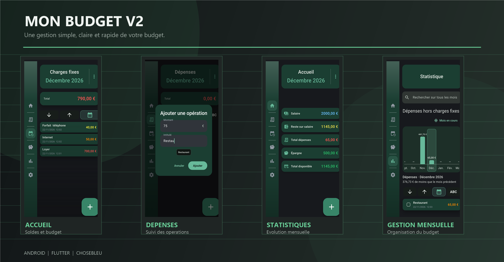
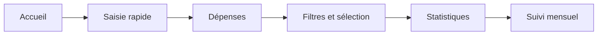
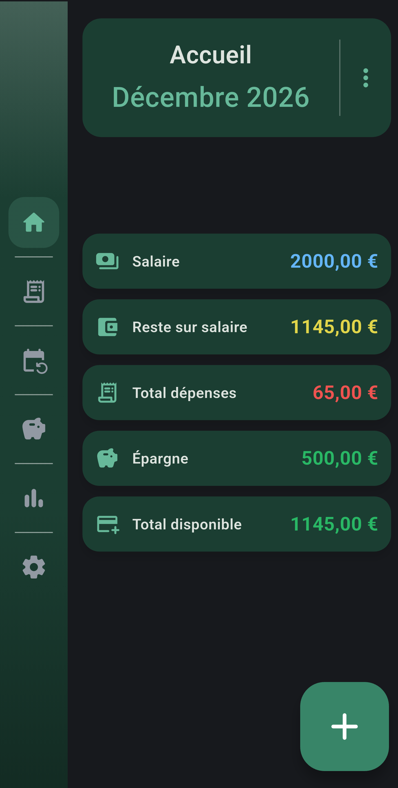

<!-- MON_BUDGET_FRISE_GRAPHIQUE -->

*Illustration de la V2 classique.*

  

<h1 align="center">Mon Budget V2.5</h1>

  <strong>Application Android de gestion de budget personnel</strong> 
  Une application Flutter pour suivre ses revenus, ses dépenses et son budget mensuel avec une interface claire ou sombre, épurée et pratique.

  
  

  <strong>Langues disponibles :</strong> 
  Français · English / Espanol / Portugues / Deutsch / Italiano / Nederlands / Polski

Développement : <strong>chosebleu</strong>

Application Android open source de gestion de budget personnel,
developpee avec Flutter par **chosebleu**.

## Mon Budget V2.5

La nouvelle generation de Mon Budget privilegie la rapidite,
la simplicite et la personnalisation.

### Fonctionnalites

- Solde reel et reste a vivre.
- Saisie rapide des depenses et revenus.
- Gestion des charges fixes.
- Gestion et historique des feuilles mensuelles.
- Statistiques interactives et filtres.
- Themes clair et sombre.
- Palettes de couleurs personnalisables.
- Ecran d'accueil personnalisable.
- Barre de navigation positionnable a gauche ou a droite.
- Widget Android de saisie rapide.
- Corbeille des feuilles mensuelles.
- Choix de la langue et de la devise.
- Stockage local des donnees.

### Langues disponibles

Francais, anglais, espagnol, portugais, allemand,
italien, neerlandais et polonais.

Le changement de devise ne convertit pas les montants.

## Telechargement

| Version | Description | Telechargement |
| --- | --- | --- |
| V2.5 | Nouvelle generation | [Releases](https://github.com/chosebleu/Mon-Budget/releases) |
| V2 classique | Version 1.1.0 | [Telecharger](https://github.com/chosebleu/Mon-Budget/releases/tag/v1.1.0) |

## Installation et mise a jour

Android 7.0 ou version ulterieure.

Telecharger l'APK officiel depuis les Releases GitHub.

Pour mettre a jour la V2 officielle vers la V2.5,
installer le nouvel APK sans desinstaller l'application.

La conservation des donnees a ete validee sur un
emulateur Android 16. Une sauvegarde reste recommandee.

## Confidentialite

Les donnees du budget sont stockees localement.

La cle privee de signature officielle ne fait pas
partie du depot public.

## Developpement

Prerequis : Flutter et Android SDK.

    flutter pub get
    flutter test
    flutter run

Les compilations locales utilisent une signature
de developpement distincte de la signature officielle.

## Licence

MIT - voir le fichier LICENSE.

## Developpeur

**chosebleu**

## Parcours de l'application

## Captures d'écran

  
  

  
  

Captures de la V2 classique. Les visuels V2.5 seront ajoutes prochainement.

