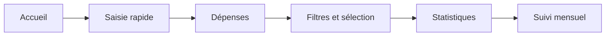
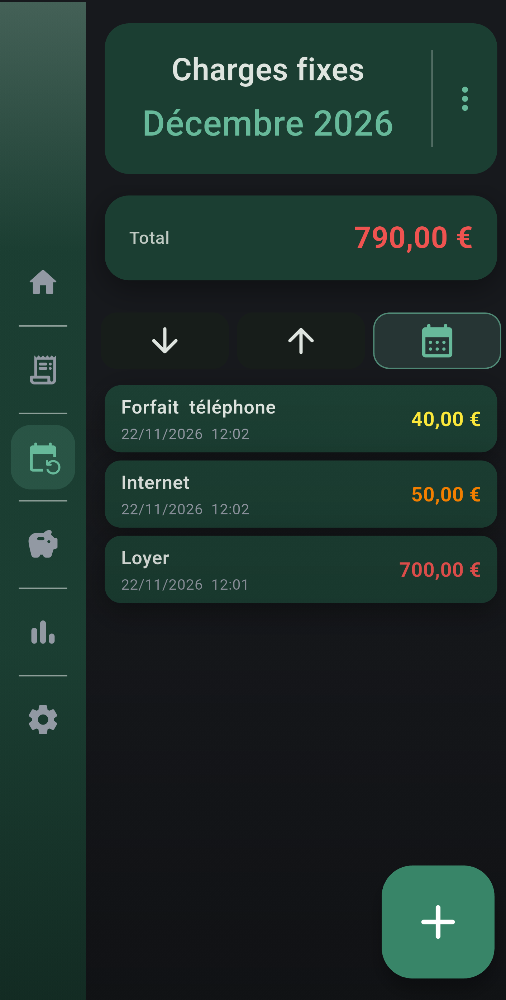
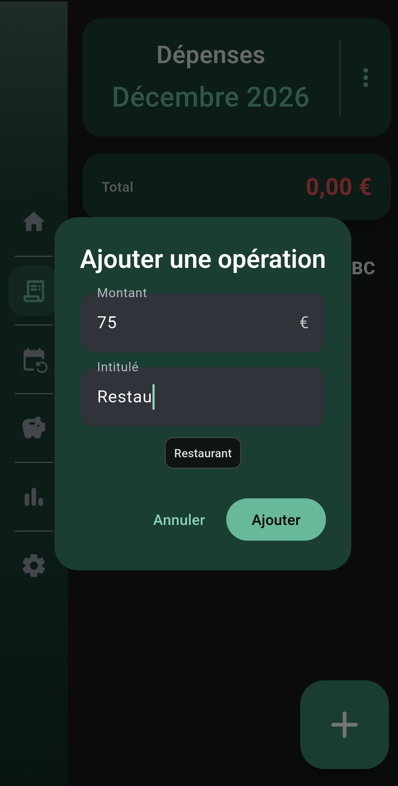
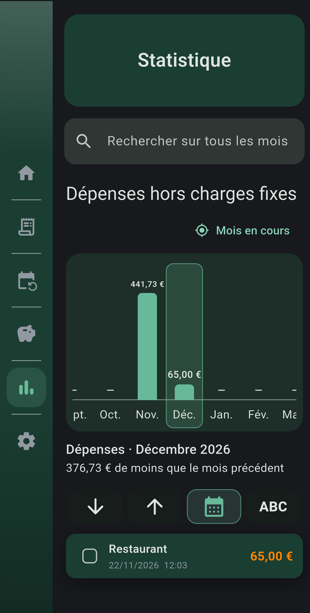

<!-- MON_BUDGET_FRISE_GRAPHIQUE -->

<p align="center">
  
</p>

<h1 align="center">Mon Budget V2</h1>

<p align="center">
  <strong>Application Android de gestion de budget personnel</strong><br>
  Une application Flutter pour suivre ses revenus, ses dépenses et son budget mensuel avec une interface sombre, épurée et pratique.
</p>

<p align="center">
  <a href="https://github.com/chosebleu/Mon-Budget/releases/latest">
    
  </a>
  <a href="https://github.com/chosebleu/Mon-Budget/releases">
    
  </a>
</p>

<p align="center">
  <strong>Langues disponibles :</strong><br>
  Français · English
</p>

<p align="center">Développement : <strong>chosebleu</strong></p>

## Fonctionnalités

| Fonction | Description |
|---|---|
| Accueil | Consultation du solde réel et du reste à vivre |
| Saisie rapide | Ajout de revenus et de dépenses |
| Dépenses | Consultation, tri et filtrage des opérations |
| Sélection multiple | Calcul du sous-total des dépenses sélectionnées |
| Statistiques | Graphique mensuel et consultation des dépenses par mois |
| Gestion mensuelle | Organisation des opérations par mois |
| Internationalisation | Interface disponible en français et en anglais |

## Parcours de l'application



## Captures d'écran

<p align="center">
  
  
</p>

<p align="center">
  
  
</p>

Les captures présentent les principaux écrans de l'application.

## Télécharger et installer

La version Android officielle est disponible dans les **[Releases GitHub](https://github.com/chosebleu/Mon-Budget/releases/latest)**.

1. Ouvrir la dernière version publiée.
2. Télécharger le fichier APK.
3. Ouvrir le fichier sur un appareil Android compatible.
4. Autoriser l'installation depuis cette source si Android le demande.
5. Installer et lancer **Mon Budget V2**.

Les mises à jour signées avec le même certificat peuvent être installées sur une version précédente compatible, sans désinstallation.

## Développement

Projet développé avec Flutter et Dart.

Prérequis : Flutter et Android SDK.

Pour récupérer les dépendances et lancer les tests :

```powershell
flutter pub get
flutter test
flutter run
```

Pour compiler un APK :

```powershell
flutter build apk --release
```

La clé de signature officielle n'est pas fournie dans ce dépôt.

## Confidentialité

L'application est conçue pour gérer un budget personnel avec un stockage local.

Aucune donnée financière personnelle ne doit être incluse dans le dépôt public, les captures d'écran ou les fichiers de démonstration.

## Licence

Ce projet est distribué sous licence MIT. Consulter le fichier [LICENSE](LICENSE).

## Développeur

**chosebleu**
